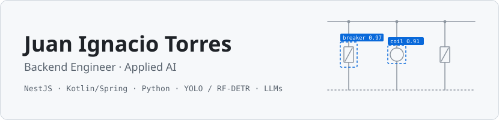
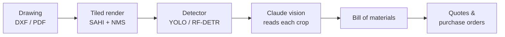

<picture>
  <source media="(prefers-color-scheme: dark)" srcset="assets/banner-dark.svg">
  
</picture>

  
  
  
  

I build the APIs, job queues and services that turn messy real-world inputs (engineering drawings, audio,
financial filings) into structured data people can act on. Software Engineering student at
**Universidad Austral**.

<table>
  <tr>
    <td><b>Backend</b></td>
    <td>TypeScript · NestJS · Prisma · Kotlin · Spring Boot · Python · FastAPI</td>
  </tr>
  <tr>
    <td><b>Data &amp; infra</b></td>
    <td>PostgreSQL · Redis Streams · Docker · Nginx · GitHub Actions</td>
  </tr>
  <tr>
    <td><b>Applied AI</b></td>
    <td>YOLO · RF-DETR (DEtection TRansformer) · LLM vision &amp; extraction (Claude) · Whisper · Ollama</td>
  </tr>
</table>

## Featured work

### Lab III · electrical drawings → bill of materials

Software Lab III, Universidad Austral · built for a real client · private repo · team of 7

Turns AutoCAD electrical panel drawings (DXF/PDF) into a bill of materials, supplier quotes and purchase orders,
replacing hours of manual counting per panel. I worked on the detection pipeline and the queue that feeds it:

- Two-stage detection service in **FastAPI**: a detector proposes *where* a symbol is, Claude reads *what* it is.
- Tiled inference over large drawings and a **grid spatial index** that replaced all-vs-all symbol grouping.
- Redesign of the **Postgres-backed job queue** between the NestJS backend and the detector, with progress
  heartbeats.

`NestJS` `Prisma` `FastAPI` `YOLO` `RF-DETR` `Claude` `React` `PostgreSQL` `Docker`

<table>
  <tr>
    <td width="50%" valign="top">
      <h3><a href="https://github.com/Bovelez/bovelez">Bovelez</a></h3>
      Stock portfolio tracker · team of 5
      
Buy and sell stocks validated against SEC EDGAR and track the portfolio with live prices.
      I set up the <b>CI pipeline</b>, the backend auth integration, the <b>SEC EDGAR + Yahoo Finance</b>
      providers and the mobile front-end.

      <code>NestJS</code> <code>Prisma</code> <code>FastAPI</code> <code>React</code> <code>Cypress</code>
    </td>
    <td width="50%" valign="top">
      <h3><a href="https://github.com/JVM-austral">Snippet Searcher</a></h3>
      Microservices platform · team of 3
      
Write, share, lint, format and run code in PrintScript, a language with its own
      <a href="https://github.com/JVM-austral/tp-ingsis-interpreter">interpreter</a>. Main author of the
      <a href="https://github.com/JVM-austral/auth-microservice">auth service</a> (Auth0 JWT + per-snippet
      permissions) and the Docker/Nginx infrastructure.

      <code>Kotlin</code> <code>Spring Boot</code> <code>Redis Streams</code> <code>PostgreSQL</code>
    </td>
  </tr>
  <tr>
    <td width="50%" valign="top">
      <h3><a href="#about-rivalmatch">RivalMatch</a></h3>
      Find rival teams and schedule matches · private repo · team of 4
      
Backend auth (Argon2, per OWASP), team management, rival search and the match acceptance flow,
      with <b>WebSockets</b> and E2E tests for every endpoint.

      <code>NestJS</code> <code>TypeScript</code> <code>WebSockets</code> <code>React</code>
    </td>
    <td width="50%" valign="top">
      <h3><a href="https://github.com/juanitorres1/siu-notas">siu-notas</a></h3>
      Side project
      
Monitors my university's student portal (SIU Guaraní) and emails me only when there's something new:
      grades, final exams and credit-earning activities.

      <code>Python</code>
    </td>
  </tr>
</table>

Also contributed to [**Transcriptor-Audios**](https://github.com/Tomas093/Transcriptor-Audios): transcribes and
summarizes WhatsApp voice notes fully offline with Whisper and a local LLM.

### About RivalMatch

Private repo · team of 4

Amateur teams post a rival search (sport, age range, skill level, gender), other teams accept or reject it, and an
accepted search becomes a match with its own chat room and result. My work on the backend:

- **Auth** with JWT (Passport) and **Argon2** password hashing, replacing bcrypt following OWASP guidance.
- **Teams**: edit and delete your own team, team password.
- **Matching flow**: accepting rival searches, search results, "my matches", and checking that both teams accepted
  before a match is confirmed.
- **WebSockets** (Socket.IO) setup used by the match chat.
- **Validation pipes** on every endpoint and **E2E tests** against a real Postgres in Docker.

`NestJS` `Prisma` `PostgreSQL` `Socket.IO` `Jest`

<b>Versión en español</b>

 

Construyo las APIs, colas de trabajo y servicios que convierten datos del mundo real (planos de ingeniería, audios,
reportes financieros) en información estructurada. Estudiante de Ingeniería en Informática en la
**Universidad Austral** (Buenos Aires). Busco roles de **backend e IA aplicada**.

- **Laboratorio III** (proyecto con un cliente real, repo privado): convierte planos eléctricos de AutoCAD en listado de materiales,
  cotizaciones y órdenes de compra. Trabajé en el pipeline de detección (**YOLO / RF-DETR + Claude visión**), la
  inferencia por tiles sobre planos grandes y el rediseño de la **cola de trabajos sobre Postgres**.
- **[Bovelez](https://github.com/Bovelez/bovelez)**: tracker de portafolios de acciones. Armé el **CI**, la
  integración de auth y los proveedores de datos **SEC EDGAR + Yahoo Finance**.
- **[Snippet Searcher](https://github.com/JVM-austral)**: plataforma de microservicios en Kotlin/Spring Boot. Autor
  principal del servicio de **auth** (JWT de Auth0 + permisos por snippet) y de la infraestructura.
- **RivalMatch** (repo privado): búsqueda de rivales y partidos entre equipos, con auth, WebSockets y tests E2E.
- **[siu-notas](https://github.com/juanitorres1/siu-notas)**: monitor del SIU Guaraní que avisa por mail las
  novedades.

